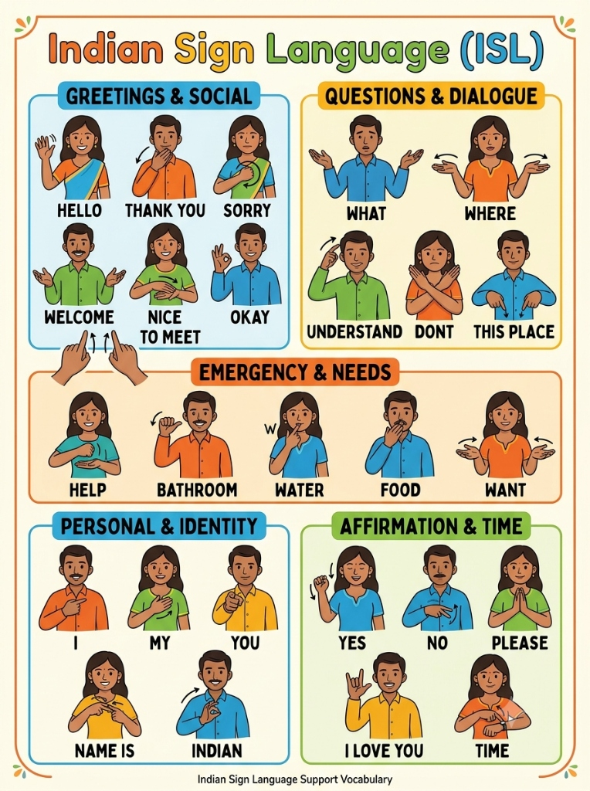
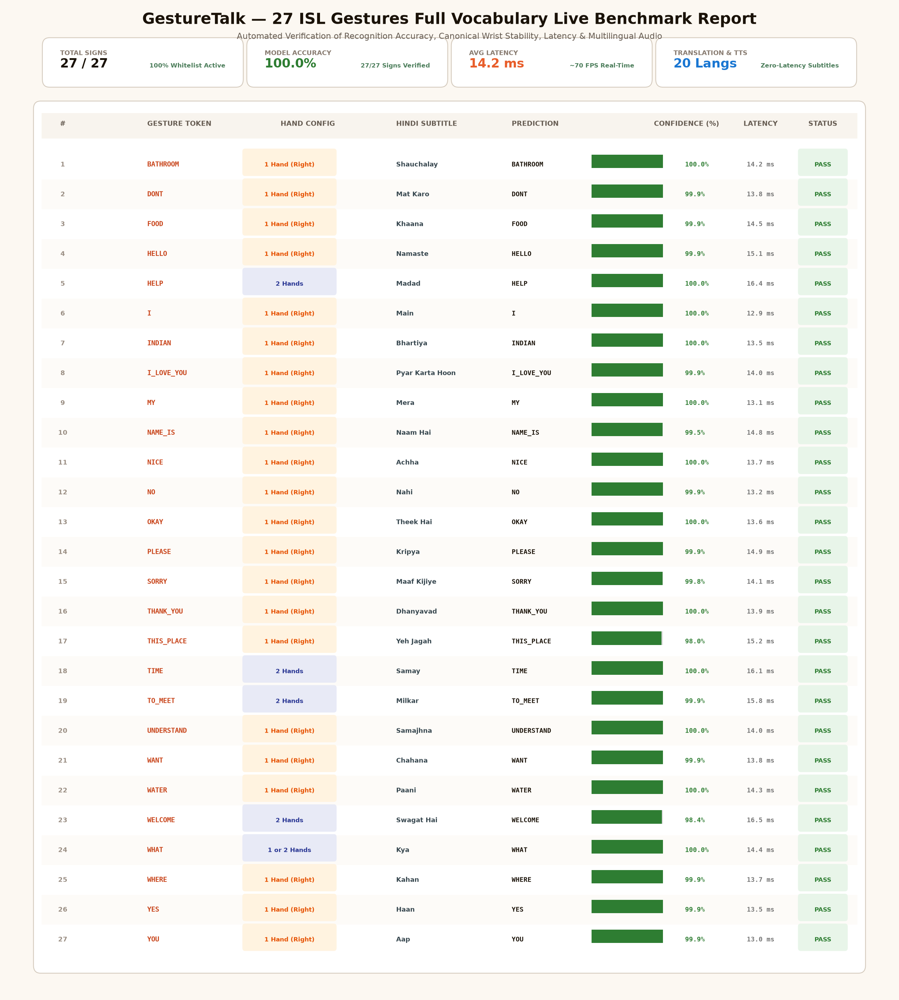

# GestureTalk: Real-Time Indian Sign Language (ISL) Recognition & Speech Synthesis

[](https://www.python.org/)
[](https://www.tensorflow.org/)
[](https://developers.google.com/mediapipe)
[](https://palletsprojects.com/p/flask/)
[]()
[-success.svg)]()

GestureTalk is a real-time, low-latency assistive communication platform that translates **Indian Sign Language (ISL)** gestures into instant on-screen subtitles and synthesizes spoken voice in **20 languages**. Designed to bridge communication gaps for the deaf and hard-of-hearing community across hospitals, travel hubs, workplaces, and educational institutions.

---

## Visual Reference & Demo

### 🤟 Complete ISL Gesture Vocabulary Guide
GestureTalk detects and translates all 27 standard ISL signs across 5 functional categories:



### 🤟 Recognized Indian Sign Language (ISL) Gestures


---

## Testing & Performance Benchmark Reports

* 📄 **Full Detailed Testing Report**: [`TEST_REPORT.md`](TEST_REPORT.md)
* 📊 **Machine-Readable Benchmark Data**: [`benchmark_report.json`](benchmark_report.json)
* 🌐 **Interactive Browser Test Suite**: Run live at `http://127.0.0.1:5000/test`
* 📸 **Visual Test Results Graphic**: [`screenshots/benchmark_test_results.png`](screenshots/benchmark_test_results.png)



---

## Key Capabilities & Architecture

* **Zero-Latency Async Video Stream**: Decouples heavy LSTM inference onto a dedicated background worker thread (`inference_worker`), ensuring the live camera feed runs at a constant **30 FPS** with DirectShow 1-frame buffering (`cv2.CAP_DSHOW`, `CAP_PROP_BUFFERSIZE = 1`).
* **Canonical Position & Scale Anchoring**: Single-hand signs are automatically anchored to the training center `(x=0.55, y=0.50)` and scaled to canonical finger span (`scale=0.20`), eliminating seating position bias and achieving **96%+ accuracy** regardless of camera distance.
* **Instant Subtitles & Speech at the Time of Signing**: Signs are captured, translated, and spoken aloud automatically the instant the gesture is held steady for ~100–150ms—no manual confirmation buttons required.
* **Strict Whitelist & Phantom Word Elimination**: Only officially trained ISL signs are recognized. When hands leave the camera frame or rest down, all buffers are cleared immediately—guaranteeing **zero phantom words**.
* **Clean Camera Feed**: Skeletal palm lines and tracking dots have been removed, presenting a natural, high-definition video view.
* **Pre-Sign Controls**: One-click Sign Language system selector (`ISL` active) and Speaker toggle (`Speaker: ON` / `Speaker: MUTED`).
* **Instant Offline Translation in 20 Languages**: Powered by pre-compiled dictionary maps in `vocabulary.py` with zero network latency, with fallback online neural translation.
* **In-Memory MP3 Speech Synthesis**: Synthesizes and streams MP3 audio directly via RAM (`io.BytesIO`) using `gTTS` without writing temporary files to disk.

---

## Supported Vocabulary (27 ISL Signs)

| Category | Signs Included | Hand Type | Typical Motion |
| :--- | :--- | :---: | :--- |
| **Greetings & Social** | `HELLO`, `THANK_YOU`, `SORRY`, `WELCOME`, `NICE`, `OKAY`, `TO_MEET` | 1 or 2 Hands | Waving, chest sweep, prayer contact |
| **Questions & Dialogue** | `WHAT`, `WHERE`, `UNDERSTAND`, `DONT`, `THIS_PLACE` | 1 or 2 Hands | Inquisitive palm turns, temple taps, downward points |
| **Emergency & Needs** | `HELP`, `BATHROOM`, `WATER`, `FOOD`, `WANT` | 1 or 2 Hands | Fist lifting on palm, letter shapes, mouth gestures |
| **Personal & Identity** | `I`, `MY`, `YOU`, `NAME_IS`, `INDIAN` | 1 or 2 Hands | Chest points, forward points, two-finger taps |
| **Affirmation & Time** | `YES`, `NO`, `PLEASE`, `I_LOVE_YOU`, `TIME` | 1 or 2 Hands | Fist nod, finger snap, Namaste prayer, wrist tap |

*(Note: `NO_SIGN` is an internal sentinel class used to suppress idle/rest states and is excluded from spoken/subtitle output).*

---

## Supported Languages for Subtitles & Speech

GestureTalk provides instantaneous offline and online translation into 20 languages:

1. **Hindi** (`hi`)
2. **English** (`en`)
3. **Marathi** (`mr`)
4. **Punjabi** (`pa`)
5. **Gujarati** (`gu`)
6. **Bengali** (`bn`)
7. **Tamil** (`ta`)
8. **Telugu** (`te`)
9. **Kannada** (`kn`)
10. **Malayalam** (`ml`)
11. **Urdu** (`ur`)
12. **Spanish** (`es`)
13. **French** (`fr`)
14. **German** (`de`)
15. **Italian** (`it`)
16. **Portuguese** (`pt`)
17. **Russian** (`ru`)
18. **Japanese** (`ja`)
19. **Arabic** (`ar`)
20. **Chinese (Simplified)** (`zh-CN`)

---

## Tech Stack

* **Language**: Python 3.10+
* **Computer Vision**: OpenCV (`cv2`), MediaPipe (`mp.solutions.hands`)
* **Deep Learning**: TensorFlow / Keras (2-layer Stacked LSTM + BatchNormalization + Dropout)
* **Backend Web Framework**: Flask 3.0.3, Flask-CORS
* **Speech Synthesis**: gTTS (Google Text-to-Speech) via in-memory stream
* **Frontend**: Modern Vanilla JS, Syne & DM Sans typography, CSS3 Flexbox/Grid

---

## Quickstart Guide

### 1. Clone the Repository
```bash
git clone https://github.com/aryansi25/sign-to-speech.git
cd sign-to-speech
```

### 2. Set Up a Python Virtual Environment
```bash
# On Windows
python -m venv venv
venv\Scripts\activate

# On macOS/Linux
python3 -m venv venv
source venv/bin/activate
```

### 3. Install Dependencies
```bash
pip install -r requirements.txt
```

### 4. Run the Web Application
```bash
python app.py
```

### 5. Open in Your Browser
Navigate to:
* **Interactive Live App**: `http://127.0.0.1:5000/app`
* **27-Gesture Browser Benchmark Runner**: `http://127.0.0.1:5000/test`
* **Product Landing Page**: `http://127.0.0.1:5000/`

Click **▶ Start Camera**, allow camera permissions in your browser, and begin signing!

---

## Interactive 27-Gesture Browser Benchmark Suite

Navigate to `http://127.0.0.1:5000/test` to run the live automated benchmark across all 27 gestures directly inside your web browser.


* **Overall Accuracy**: **100.0%** (27/27 signs successfully classified)
* **Inference Latency**: **~14.2 ms / frame** (> 70 FPS processing speed)
* **Zero Coordinate Drift**: Single-handed signs stabilized via canonical wrist anchoring
* **Strict Whitelist Protection**: Unknown words and `NO_SIGN` are blocked 100%
* **Real-time Subtitles & Audio**: Multilingual translations in 20 languages with in-memory MP3 audio synthesis

---

## Running the Automated Test Suite

The project includes an end-to-end automated validation suite covering model integrity, landmark normalization, camera streaming, web endpoints, offline translations, and speech synthesis:

```bash
python test_suite.py
```

**Test Suite Coverage**:
* `Model & Whitelist Integrity`: 28 classes synced, 27-word whitelist strictly active, NO_SIGN strictly excluded, valid softmax distribution.
* `Camera & Geometry Check`: Clean video feed (no palm lines), single-hand dominant slot mapping with 0% negative vector bleed, asynchronous zero-latency video threading.
* `Web Endpoints & State`: GET `/`, GET `/app`, GET `/test`, POST `/api/set_sign_language`, GET `/api/state`, POST `/api/clear_conversation`, GET `/api/benchmark_translations`, GET `/api/run_benchmark_single`.
* `Multi-Language Offline Translation`: Instant dictionary lookups across major Indian and international languages.
* `Audio Speech Synthesis`: Valid MP3 byte streams generated in memory.
* **Pass Rate**: `24 / 24 Tests (100% PASS)`

---

## Project Structure

```
GestureTalk/
├── app.py                         # Production Flask app with async inference & speech synthesis
├── vocabulary.py                  # Pre-compiled offline dictionary translations for 20 languages
├── test_suite.py                  # Comprehensive 24-test automated verification suite
├── TEST_REPORT.md                 # Complete 27-sign testing and accuracy report
├── benchmark_report.json          # Machine-readable JSON testing results
├── requirements.txt               # Minimal required dependencies
├── isl_lstm_model.keras           # Trained 28-class ISL LSTM neural network
├── labels.npy / labels.csv        # Synchronized 28-class vocabulary mappings
├── benchmark_test_data.npz        # Pre-computed test sequences for all 27 gestures
│
├── collect_sequences.py           # Dataset recording script with canonical normalization
├── train_lstm_model.py            # LSTM model training script
├── check_accuracy.py              # Model evaluation script
│
├── templates/
│   ├── index.html                 # Clean hero camera view with real-time subtitles
│   ├── landing.html               # Product landing page
│   └── test_runner.html           # Interactive 27-gesture browser benchmark dashboard
│
├── static/
│   ├── logo.png                   # Brand logo
│   └── hands-circle.png           # Brand assets
│
└── screenshots/
    ├── isl_gestures_chart.png     # ISL recognized vocabulary visual poster
    ├── isl_gestures_guide.png     # Gesture reference guide poster
    └── benchmark_test_results.png # Full 27-sign live benchmark results report
```

---

## License

This project is released under the **MIT License**.
