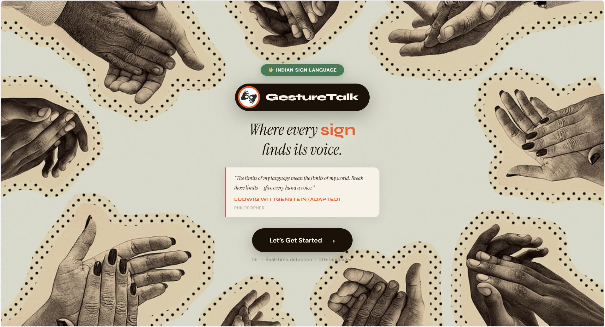
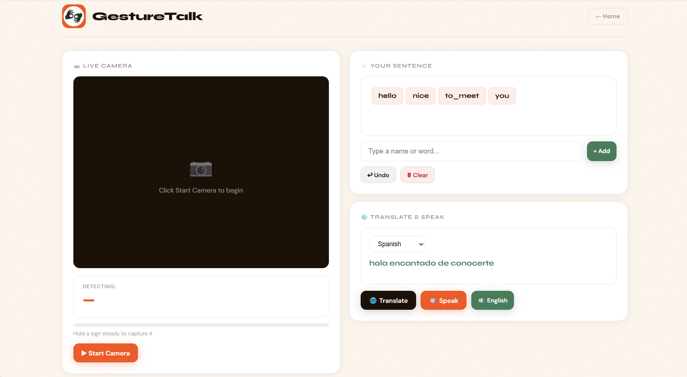
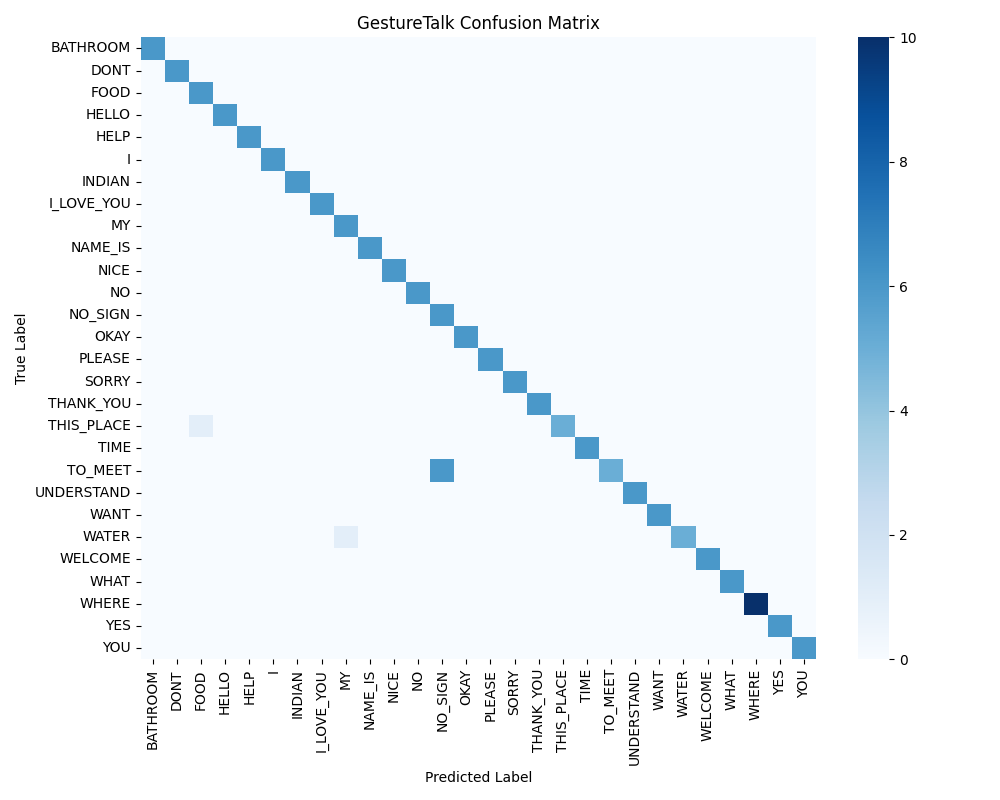
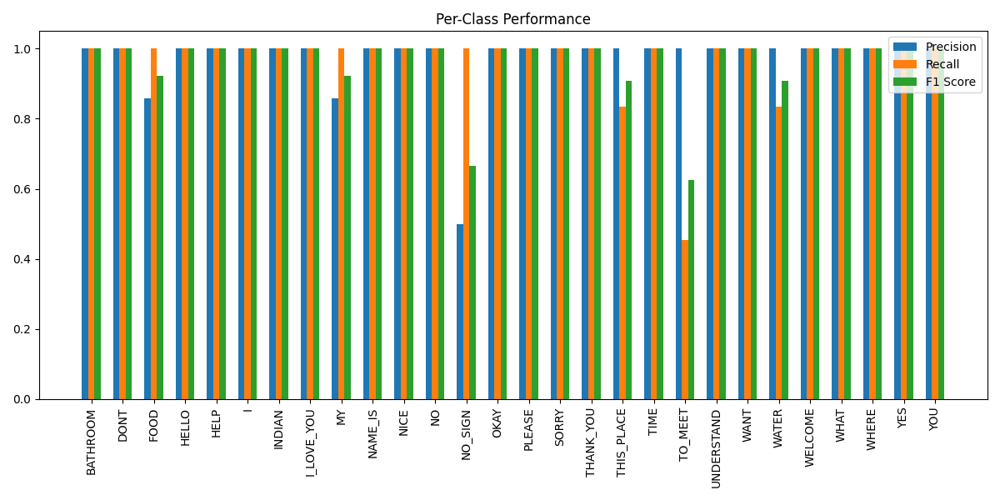

# GestureTalk: Real-Time Indian Sign Language Recognition & Translation

GestureTalk is a real-time web application that recognises **Indian Sign Language (ISL)** gestures from a webcam, turns them into text, and then **translates and speaks the result in 20 languages**. It was built as my final-year project for the B.Sc. in Data Science.

The goal is simple: reduce the everyday communication gap between ISL users and people who don't sign, in places like hospitals, travel, education, and workplaces.


---

## Demo

> Screenshots of the app in action.




---

## What it does

- **Recognises ISL gestures in real time** from your webcam
- **Builds sentences** by confirming one recognised word at a time
- **Translates** the sentence into **20 languages**
- **Speaks** the translated sentence aloud (text-to-speech)
- Runs entirely in the **browser** through a local Flask server

## Vocabulary

The model recognises **27 ISL signs** plus a `NO_SIGN` idle state (28 classes total), including:

`HELLO` · `THANK_YOU` · `PLEASE` · `SORRY` · `YES` · `NO` · `HELP` · `WATER` · `FOOD` · `BATHROOM` · `I_LOVE_YOU` · `MY` · `NAME_IS` · `WELCOME` · `WHERE` · `WHAT` · `TIME` · `UNDERSTAND` · `NICE` · `TO_MEET` · `WANT` · `OKAY` · `INDIAN` · `YOU` · `I` · `THIS_PLACE` · `DONT`

---

## How it works

1. **Hand tracking**: [MediaPipe](https://developers.google.com/mediapipe) detects 21 three-dimensional landmarks per hand (both hands → 126 numbers per frame).
2. **Normalisation**: landmarks are centred and scaled so recognition works regardless of where the hand is on screen.
3. **Sequence model**: a window of **20 frames** is fed to a trained **LSTM** neural network, which classifies the gesture.
4. **Stabilisation**: predictions are averaged and "held" briefly so only confident, steady signs are accepted.
5. **Translate & speak**: the confirmed sentence is translated (Google Translate, via `deep-translator`) and converted to speech (`gTTS`).

### Model architecture
Two stacked LSTM layers (128 units each) with Batch Normalisation and Dropout, followed by two Dense layers producing a 28-class softmax output.

### Results
The model reaches **≈95.48% validation accuracy** on a self-collected ISL dataset.




---

## The dataset (built by hand)

The dataset was **collected from scratch** for this project, not downloaded, using the included `collect_sequences.py` script and a regular webcam. It contains **28 gesture classes** and roughly **940 gesture sequences**, stored as normalised MediaPipe landmark arrays (numbers only, no images or video).

The raw dataset is **not included in this repository** to keep it lightweight and private. The **trained model (`isl_lstm_model.keras`) is included**, so the app runs without it. If you want to rebuild the dataset yourself, run `collect_sequences.py` and follow the on-screen prompts.

---

## Tech stack

| Area | Tools |
|------|-------|
| Language | Python |
| Computer vision | MediaPipe, OpenCV |
| Deep learning | TensorFlow / Keras (LSTM) |
| Web backend | Flask, Flask-CORS |
| Translation | deep-translator (Google Translate) |
| Speech | gTTS |
| Frontend | HTML, CSS, JavaScript |

---

## Run it locally

The app runs on your own computer at `http://127.0.0.1:5000`. You'll need **Python 3.10 or newer** installed, and a **webcam**.

Open **Command Prompt (cmd)** and run these steps one at a time:

**1. Get the project**
```cmd
git clone https://github.com/sharonmary15/GestureTalk.git
cd GestureTalk
```

**2. (Recommended) Create a virtual environment**

This keeps the project's packages separate from the rest of your computer.
```cmd
python -m venv venv
venv\Scripts\activate
```

**3. Install the required packages**
```cmd
pip install -r requirements.txt
```

**4. Start the app**
```cmd
python app.py
```

**5. Open it in your browser**

Once you see a message saying the server is running, open:
```
http://127.0.0.1:5000
```
Allow camera access when the browser asks, and start signing.

> **Tip:** to stop the app, go back to the Command Prompt window and press `Ctrl + C`.

---

## Project structure

```
GestureTalk/
├── app.py                      # Main Flask web app
├── requirements.txt            # Packages needed to run the app
├── isl_lstm_model.keras        # Trained model (lets the app run)
├── labels.csv / labels.npy     # Gesture class labels
├── templates/                  # Web pages (landing + app)
├── static/                     # Logo and images
│
├── collect_sequences.py        # Script used to record the dataset
├── train_lstm_model.py         # Script used to train the model
├── check_accuracy.py           # Evaluates model accuracy
├── dataset_analysis.py         # Summarises the dataset
├── generate_results_figures.py # Produces the result charts
│
├── confusion_matrix.png        # Result charts
├── overall_metrics.png
└── per_class_metrics.png
```

> Note: the data-collection, training, and evaluation scripts require the raw dataset (not included). The web app does **not** need them.

---

## Known limitations

- **Speech output** uses an online service (`gTTS`), so it needs an active internet connection; text recognition and translation are unaffected if you're offline.
- Recognition works best with **good lighting** and the hands clearly in frame.
- The current vocabulary is **27 signs**: a foundation meant to be expanded.

## Future scope

Expand the gesture vocabulary, support continuous sentence-level signing, improve robustness in varied lighting, and adapt the pipeline to other sign languages.

---

## Author

**Sharonmary Lazer Baptist Anthony**
B.Sc. Data Science, Mulund College of Commerce (Autonomous), University of Mumbai
Project guide: Dr. Priti Pathak

Full project documentation is included in this repository: [GestureTalk_Project_Documentation.pdf](GestureTalk_Project_Documentation.pdf).
